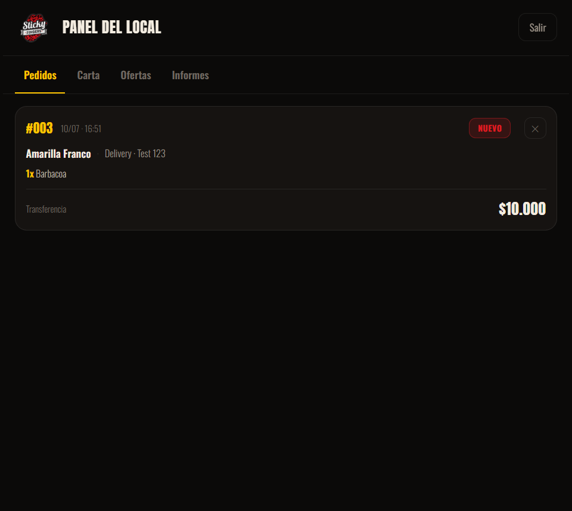
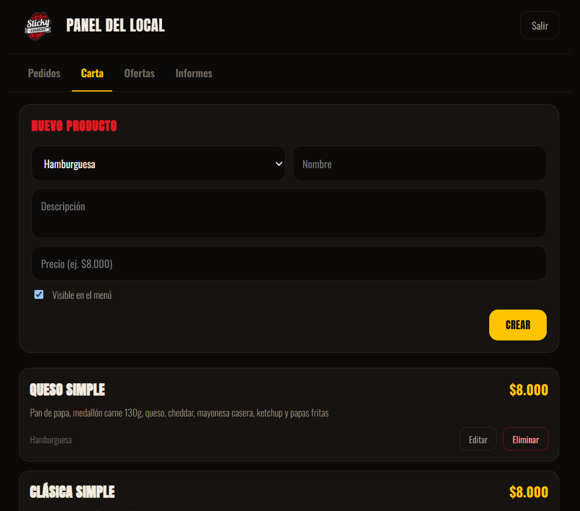
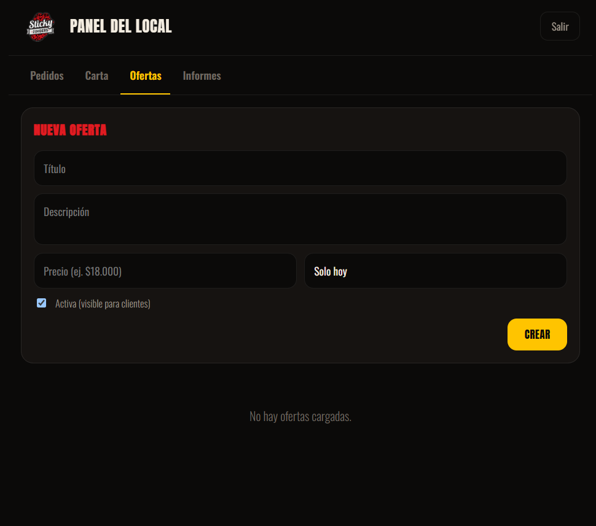
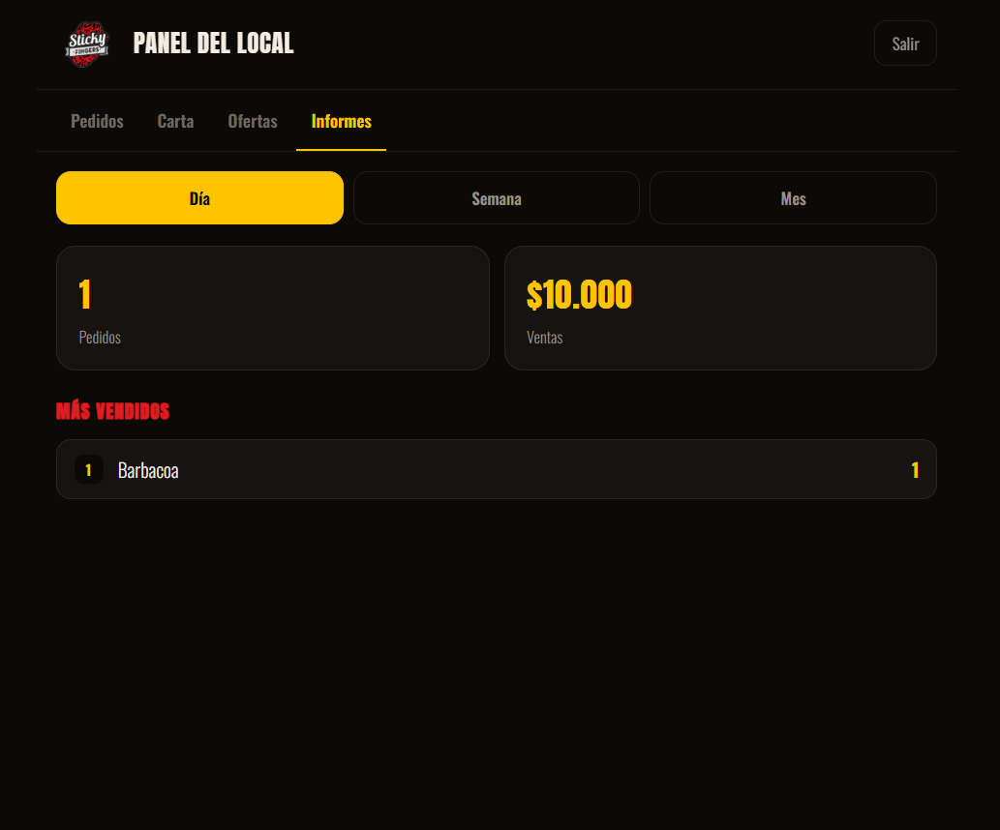
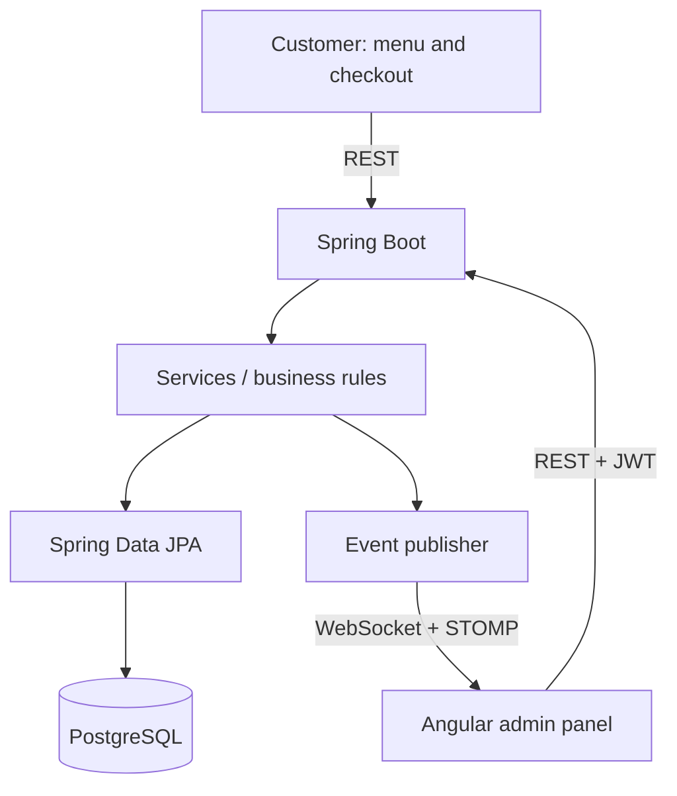

# Sticky Fingers — Online Food Ordering System

Full-stack food ordering platform featuring a digital menu, shopping cart, checkout and an administrative panel with real-time order updates.

The system incorporates WebSocket and STOMP communication, backend business-rule validation, automated tests and an architecture designed for containerized deployment.

[Versión en español](README.md)

## Features

- **Customer:** menu, cart, guest checkout, pickup or delivery.
- **Admin panel:** real-time orders, menu management, offers and sales reports.
- **Backend:** catalog-based price calculation, delivery rules, order numbering and soft deletion.
- **Security:** administrative API protected by JWT and the ADMIN role.

## Admin panel

| Real-time orders | Menu management |
| --- | --- |
|  |  |
| **Offers** | **Sales reports** |
|  |  |

## Architecture

The REST API handles operations. New order and status-change events update the panel without reloading the page.

[Architecture](docs/en/architecture.md) · [Real-time communication](docs/en/realtime.md)

## Business rules

The server recalculates totals using catalog prices. The six-burger limit applies to the relevant product lines. Delivery is calculated by distance when valid coordinates are within the configured radius; otherwise delivery remains pending coordination. Orders use sequence-based numbering and soft deletion.

[Business rules](docs/en/business-rules.md)

## Testing

Unit tests with JUnit 5 and Mockito, and API integration tests with Spring Boot Test, MockMvc and H2. They cover price calculations, delivery, validation, events, authentication and soft deletion. JaCoCo is configured to generate coverage reports.

[Testing and execution](docs/en/testing.md)

## Tech stack

| Layer | Technologies |
|---|---|
| Backend | Java 21, Spring Boot 3.3.5, Spring Data JPA, MapStruct |
| Frontend | Angular 22, TypeScript, Angular Material, RxJS, Signals |
| Security | Spring Security, JWT, BCrypt |
| Real-time | WebSocket, STOMP, SockJS |
| Data | PostgreSQL 16, Flyway |
| Testing | JUnit 5, Mockito, Spring Boot Test, H2, JaCoCo |
| API | Swagger/OpenAPI |
| Infrastructure | Docker, Docker Compose, nginx |

## Local setup

Requirements: Docker with Compose, Java 21 and Node.js 22.22.3 or later compatible with Angular 22.

1. Start PostgreSQL with `docker compose up -d postgres`.
2. Configure ADMIN_USERNAME, ADMIN_PASSWORD and a local JWT_SECRET; run the backend with `./mvnw spring-boot:run`.
3. In frontend, install dependencies with `npm install` and run `npm start`.

Customer: http://localhost:4200 · Panel: http://localhost:4200/panel · API: http://localhost:8080/swagger-ui.html

[Setup guide](docs/en/setup.md) · [Deployment](docs/en/deployment.md)

## Project status

Portfolio application deployed to a Linux VPS using containers and HTTPS, without commercial usage. Current public demo availability is not claimed. A security review must be completed before commercial operation.

## Documentation

- [Architecture](docs/en/architecture.md)
- [Real-time communication](docs/en/realtime.md)
- [Business rules](docs/en/business-rules.md)
- [Testing](docs/en/testing.md)
- [Setup](docs/en/setup.md)
- [Deployment](docs/en/deployment.md)

CLAUDE.md and DEPLOY.md preserve historical planning context (Spanish). The guides above describe the current implementation and configuration.

[Portfolio](https://francoamarilla.github.io/portfolio/) · [LinkedIn](https://www.linkedin.com/in/franco-maximiliano-amarilla/)
