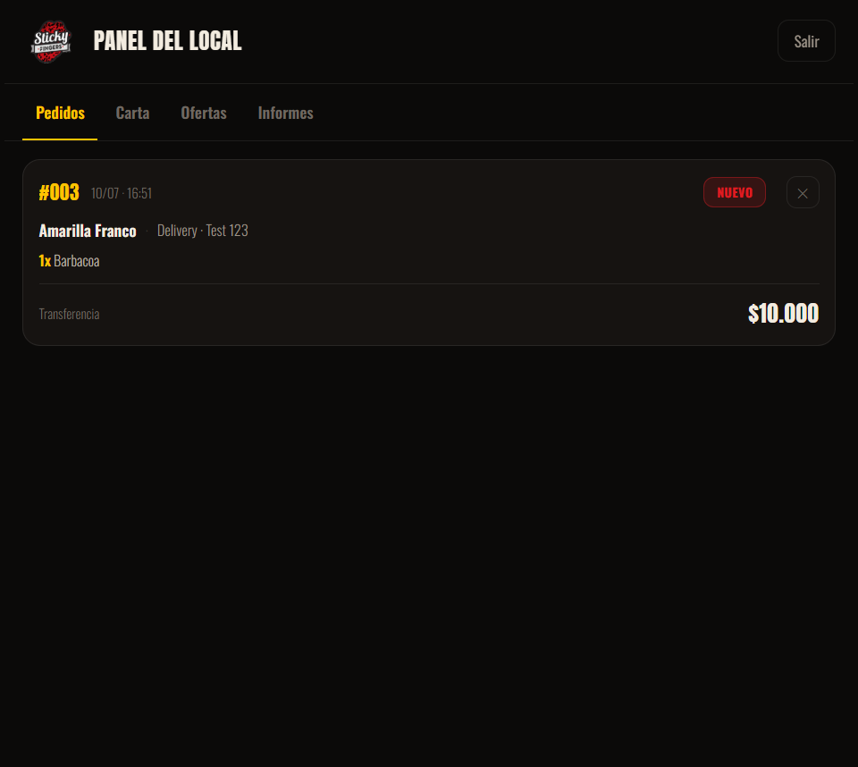
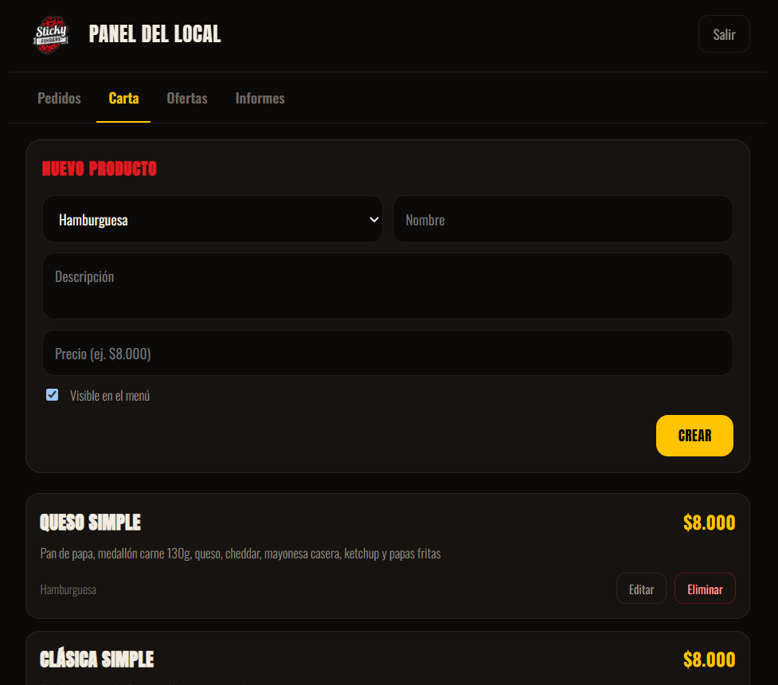
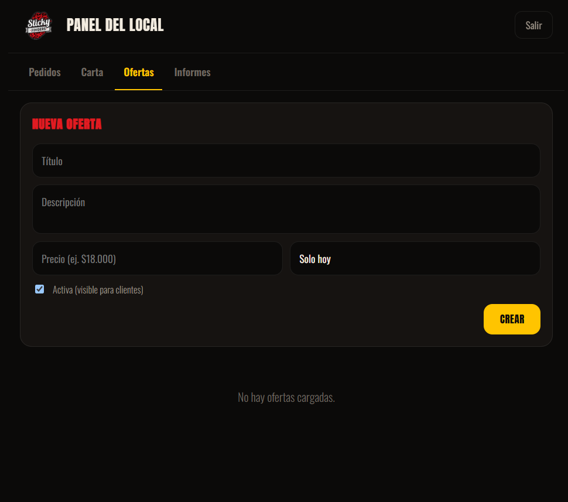
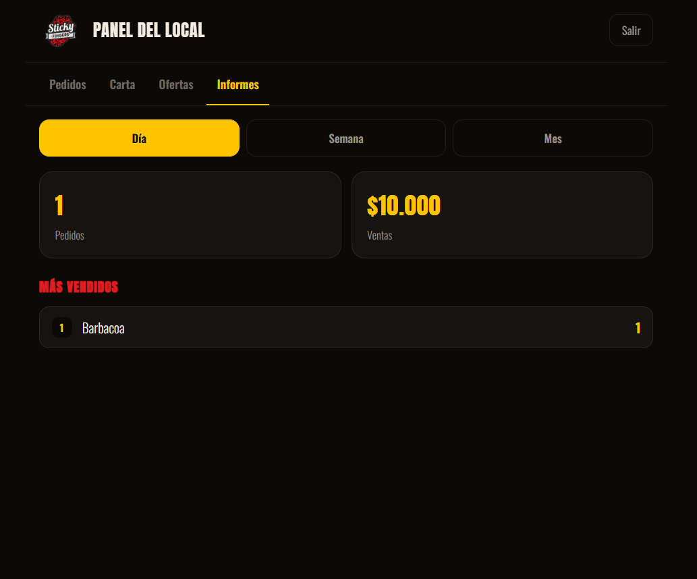
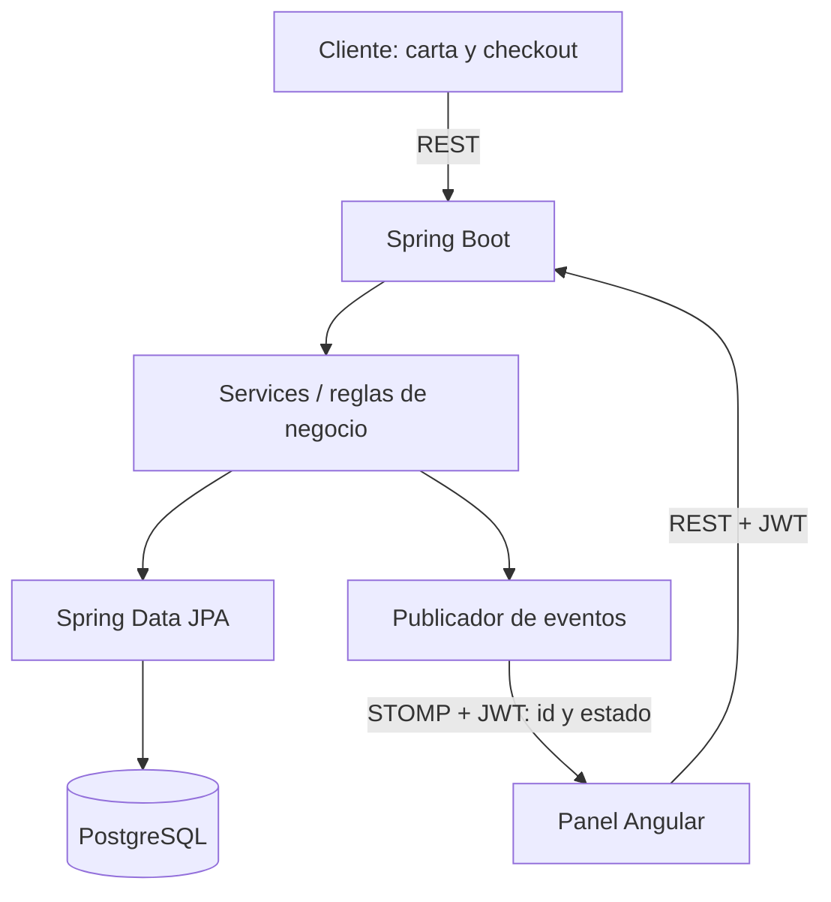

# Sticky Fingers — Sistema de gestión de pedidos gastronómicos

Plataforma Full Stack de pedidos gastronómicos que integra un catálogo digital, carrito de compras, checkout y un panel administrativo con actualización de pedidos en tiempo real.

El sistema incorpora comunicación mediante WebSockets y STOMP, validación de reglas de negocio en el backend, pruebas automatizadas y una arquitectura preparada para el despliegue mediante contenedores.

[English version](README.md)

## Funcionalidades

- **Cliente:** catálogo, carrito, checkout sin cuenta, retiro o delivery.
- **Panel administrativo:** pedidos en tiempo real, gestión de carta, ofertas e informes de ventas.
- **Backend:** cálculo de importes a partir del catálogo, reglas de entrega, numeración y baja lógica de pedidos.
- **Seguridad:** API administrativa protegida con JWT y rol ADMIN. El canal STOMP usa el mismo JWT en el CONNECT: solo ADMIN puede conectarse y suscribirse, el SEND de clientes está bloqueado y los eventos solo llevan el id y el estado del pedido.

## Panel del local

| Pedidos en tiempo real | Gestión de carta |
| --- | --- |
|  |  |
| **Ofertas** | **Informes de ventas** |
|  |  |

## Arquitectura

La API REST gestiona las operaciones. Después de cada commit, los eventos de nuevos pedidos y cambios de estado notifican al panel, que pide el detalle por la API REST protegida y se actualiza sin recargar la página.

[Arquitectura](docs/architecture.md) · [Comunicación en tiempo real](docs/realtime.md)

## Reglas de negocio

El servidor recalcula importes con precios del catálogo. El límite de seis hamburguesas se aplica a las líneas de producto correspondientes. La entrega se calcula por distancia cuando hay coordenadas válidas dentro del radio configurado; fuera de ese supuesto, el envío queda pendiente de coordinación. Los pedidos tienen numeración por secuencia y baja lógica.

[Reglas de negocio](docs/business-rules.md)

## Testing

Pruebas unitarias con JUnit 5 y Mockito, e integración de API con Spring Boot Test, MockMvc y H2. Incluyen cálculos de importes, entrega, validaciones, eventos, autenticación y eliminación lógica, además de pruebas de integración de seguridad STOMP (autenticación, autorización ADMIN, vencimiento del token, publicación después del commit) y specs de Vitest para la sincronización en tiempo real del panel. JaCoCo está configurado para generar reportes de cobertura.

[Pruebas y ejecución](docs/testing.md)

## Stack tecnológico

| Capa | Tecnologías |
|---|---|
| Backend | Java 21, Spring Boot 3.3.5, Spring Data JPA, MapStruct |
| Frontend | Angular 22, TypeScript, Angular Material, RxJS, Signals |
| Seguridad | Spring Security, JWT, BCrypt |
| Tiempo real | WebSocket, STOMP, SockJS |
| Datos | PostgreSQL 16, Flyway |
| Testing | JUnit 5, Mockito, Spring Boot Test, H2, JaCoCo |
| API | Swagger/OpenAPI |
| Infraestructura | Docker, Docker Compose, nginx |

## Ejecución local

Requisitos: Docker con Compose, Java 21 y Node.js 22.22.3 o posterior compatible con Angular 22.

1. Iniciar PostgreSQL con `docker compose up -d postgres`.
2. Configurar ADMIN_USERNAME, ADMIN_PASSWORD y un JWT_SECRET local; ejecutar el backend con `./mvnw spring-boot:run`.
3. En frontend, instalar dependencias con `npm install` y ejecutar `npm start`.

Cliente: http://localhost:4200 · Panel: http://localhost:4200/panel · API: http://localhost:8080/swagger-ui.html

[Guía de instalación](docs/setup.md) · [Despliegue](docs/deployment.md)

## Estado del proyecto

Aplicación de portfolio. Estuvo desplegada en un VPS Linux mediante contenedores y HTTPS, sin uso comercial, y actualmente no está desplegada. Antes de una puesta en funcionamiento comercial corresponde completar la revisión de seguridad.

## Documentación

- [Arquitectura](docs/architecture.md)
- [Comunicación en tiempo real](docs/realtime.md)
- [Reglas de negocio](docs/business-rules.md)
- [Testing](docs/testing.md)
- [Instalación](docs/setup.md)
- [Despliegue](docs/deployment.md)

Los archivos CLAUDE.md y DEPLOY.md conservan el contexto histórico de planificación. Las guías de arriba describen la implementación y configuración actual.

[Portfolio](https://francoamarilla.github.io/portfolio/) · [LinkedIn](https://www.linkedin.com/in/franco-maximiliano-amarilla/)
