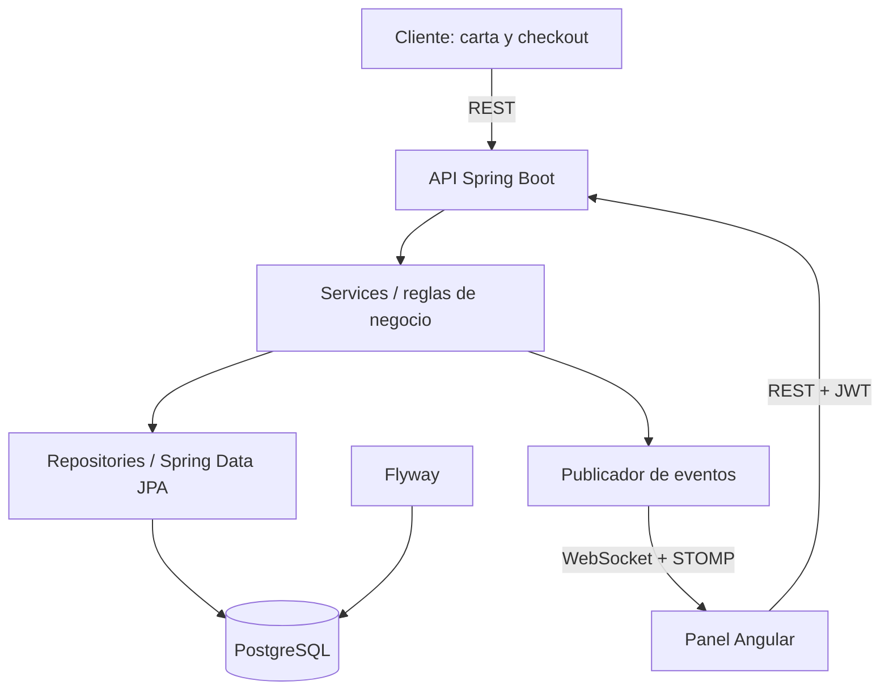

# Arquitectura

[English version](en/architecture.md) · [README](../README.md)

Sticky Fingers separa la experiencia pública de compra del panel administrativo. Ambos consumen la API REST de Spring Boot; el panel recibe además eventos mediante STOMP.

## Responsabilidades

- **Angular:** catálogo, carrito, checkout y panel de pedidos, ofertas e informes. Signals y RxJS actualizan el estado de la interfaz.
- **Controllers:** contratos HTTP, DTOs y validación de solicitudes.
- **Services:** cálculo de importes, entrega, creación y cambio de estado de pedidos.
- **Repositories:** persistencia mediante Spring Data JPA.
- **PostgreSQL:** almacenamiento de pedidos y catálogo; Flyway administra el esquema.
- **Publicador de eventos:** distribuye notificaciones de pedidos mediante Spring Messaging.

## Seguridad

La API administrativa exige JWT y rol ADMIN. Los clientes pueden consultar la carta y registrar pedidos sin iniciar sesión. El backend utiliza sesiones stateless y BCrypt para contraseñas. La autorización de la API REST no implica por sí sola autorización de todos los canales de comunicación: el endurecimiento de seguridad debe completarse antes de un uso comercial.

Ver [tiempo real](realtime.md), [reglas de negocio](business-rules.md) y [testing](testing.md).
