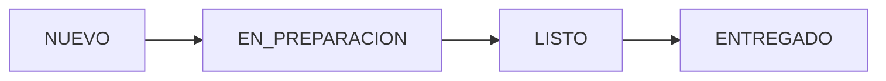

# Reglas de negocio

[English version](en/business-rules.md) · [README](../README.es.md)

## Checkout

El servidor obtiene los precios de productos y ofertas, calcula el subtotal y suma el envío cuando corresponde. No utiliza un total proporcionado por el cliente como fuente de verdad. El medallón extra tiene un importe configurable. Se admiten efectivo y transferencia sin recargo por medio de pago.

El límite de seis hamburguesas se aplica a las líneas de productos de tipo HAMBURGUESA. Las ofertas se procesan como líneas independientes; no se contabiliza su contenido dentro de ese límite en el servicio actual.

## Entrega

- Retiro: sin costo de envío.
- Delivery con coordenadas dentro del radio configurado (3 km en la configuración actual): cálculo por distancia geográfica mediante Haversine, tramos y recargo por lluvia.
- Delivery sin coordenadas o fuera del radio: el pedido se registra con envío pendiente de coordinación por el local, sin importe de envío automático. No equivale a envío gratuito.

## Pedidos

Este es el flujo de avance por defecto. La API administrativa también permite indicar un estado explícito; no se afirma una máquina de estados estricta. El servicio utiliza una secuencia para numerar los pedidos y realiza baja lógica, conservando la fila del pedido.

El servicio declara transacciones para crear, cambiar de estado y eliminar pedidos.

Fuentes: [PedidoService](../backend/src/main/java/com/stickyburgers/service/PedidoService.java), [CostoEnvioService](../backend/src/main/java/com/stickyburgers/service/CostoEnvioService.java), [EstadoPedido](../backend/src/main/java/com/stickyburgers/domain/EstadoPedido.java).
