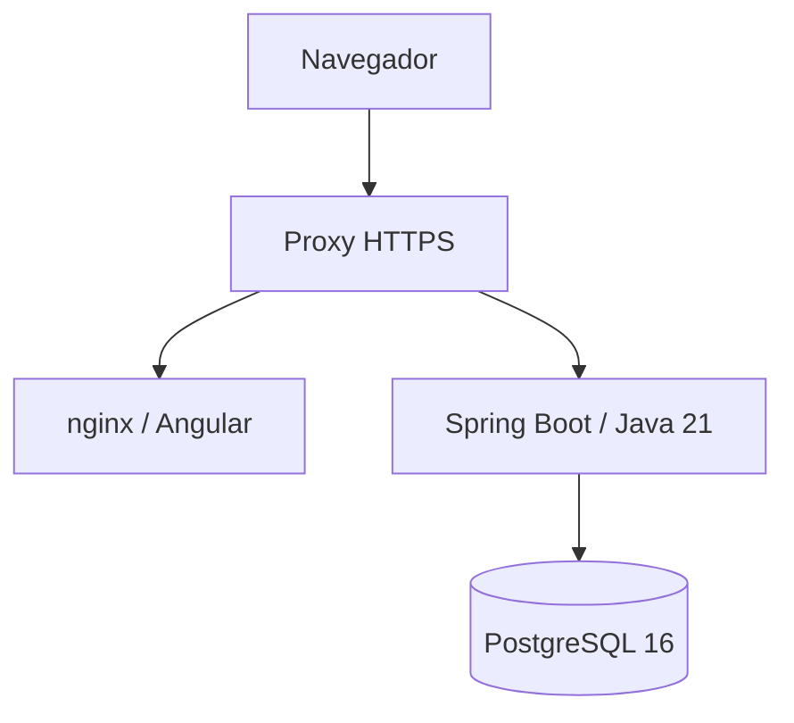

# Despliegue y contenedorización

[English version](en/deployment.md) · [README](../README.md)

El proyecto cuenta con Dockerfiles multi-stage para backend y frontend, y una configuración Compose de verificación del stack.



## Componentes

- Backend: Maven y Java 21 para build, JRE 21 para ejecución.
- Frontend: Node 22 para build y nginx para servir los archivos estáticos.
- PostgreSQL 16: persistencia con volumen y migraciones Flyway.
- Configuración de producción: perfil prod, credenciales y orígenes mediante variables de entorno.

El Dockerfile del backend empaqueta con pruebas omitidas; ejecutar la suite por separado antes de desplegar.

## Verificación local de imágenes

```bash
docker compose -f docker-compose.prod.yml up --build
```

Este archivo es para verificación local, no un despliegue público listo para usar. La compilación del frontend de producción apunta a un dominio configurado, por lo que este comando no garantiza una prueba end-to-end frontend/backend en localhost. Revisar y configurar las URLs y los secretos antes de cualquier despliegue.

## Estado

La aplicación fue desplegada en un VPS Linux con contenedores y HTTPS como proyecto de portfolio, sin uso comercial. El plan histórico [DEPLOY.md](../DEPLOY.md) describe DigitalOcean y Coolify y contiene ejemplos que deben contrastarse con la configuración actual. No se afirma que el entorno continúe activo ni que se hayan ejecutado todas las fases del plan.

Referencias: [Dockerfile backend](../backend/Dockerfile), [Dockerfile frontend](../frontend/Dockerfile), [Compose de verificación](../docker-compose.prod.yml).
