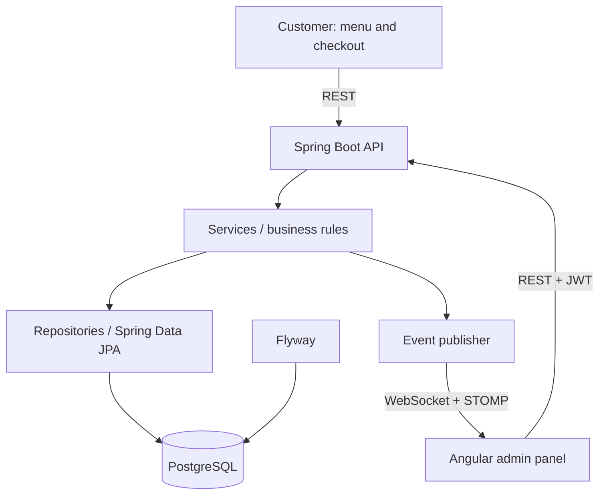

# Architecture

[Versión en español](../architecture.md) · [README](../../README.en.md)

Sticky Fingers separates the public ordering experience from the administrative panel. Both consume the Spring Boot REST API; the panel also receives STOMP events.

## Responsibilities

- **Angular:** menu, cart, checkout and order, offer and reporting panel. Signals and RxJS update UI state.
- **Controllers:** HTTP contracts, DTOs and request validation.
- **Services:** price calculations, delivery, order creation and state changes.
- **Repositories:** persistence through Spring Data JPA.
- **PostgreSQL:** storage for orders and catalog; Flyway manages the schema.
- **Event publisher:** distributes order notifications through Spring Messaging.

## Security

The administrative API requires JWT and the ADMIN role. Customers can browse the menu and submit orders without signing in. The backend uses stateless sessions and BCrypt for passwords. REST API authorization does not by itself authorize all communication channels: security hardening must be completed before commercial use.

See [real-time communication](realtime.md), [business rules](business-rules.md) and [testing](testing.md).
