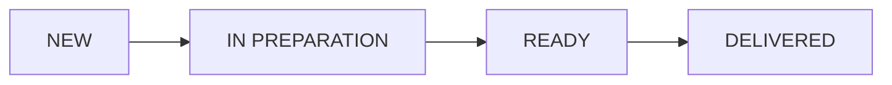

# Business rules

[Versión en español](../business-rules.md) · [README](../../README.md)

## Checkout

The server retrieves product and offer prices, calculates the subtotal and adds delivery when applicable. It does not treat a client-supplied total as the source of truth. The extra patty price is configurable. Cash and bank transfer are accepted without payment-method surcharges.

The six-burger limit applies to product lines of type HAMBURGUESA. Offers are handled as separate lines; their contents are not counted toward that limit by the current service.

## Delivery

- Pickup: no delivery charge.
- Delivery with coordinates within the configured radius (3 km in the current configuration): geographic distance calculated using Haversine, distance bands and a rain surcharge.
- Delivery without coordinates or outside the radius: the order is recorded for the shop to coordinate delivery, without an automatic delivery charge. This does not mean free delivery.

## Orders

This is the default progression. The administrative API also accepts an explicit state; a strict state machine is not claimed. The service uses a sequence for order numbers and soft deletion, retaining the order row.

The service declares transactions for order creation, state changes and deletion.

Sources: [PedidoService](../../backend/src/main/java/com/stickyburgers/service/PedidoService.java), [CostoEnvioService](../../backend/src/main/java/com/stickyburgers/service/CostoEnvioService.java), [EstadoPedido](../../backend/src/main/java/com/stickyburgers/domain/EstadoPedido.java).
