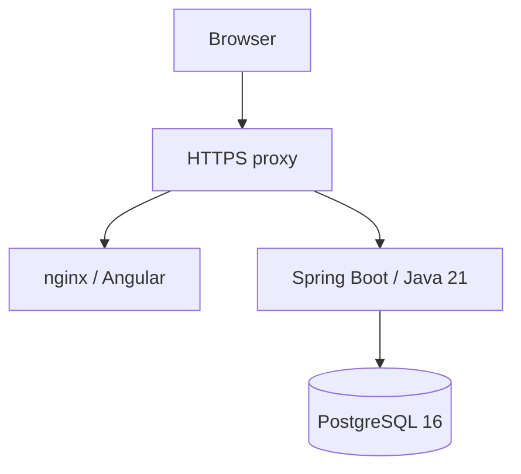

# Deployment and containerization

[Versión en español](../deployment.md) · [README](../../README.md)

The project contains multi-stage Dockerfiles for backend and frontend, and a Compose configuration for stack verification.



## Components

- Backend: Maven and Java 21 for build, JRE 21 for runtime.
- Frontend: Node 22 for build, nginx for static assets.
- PostgreSQL 16: volume-backed persistence and Flyway migrations.
- Production configuration: prod profile, credentials and origins through environment variables.

The backend Dockerfile packages with tests skipped; run the suite separately before deployment.

## Local image verification

```bash
docker compose -f docker-compose.prod.yml up --build
```

This file is for local verification, not a ready-to-use public deployment. The production frontend build points to a configured domain, so the command does not guarantee an end-to-end frontend/backend test on localhost. Review URLs and secrets before deployment.

## Status

The application was deployed to a Linux VPS with containers and HTTPS as a portfolio project, without commercial usage. The historical [DEPLOY.md](../../DEPLOY.md) plan describes DigitalOcean and Coolify, with examples that must be checked against the current configuration. Current availability and completion of every phase are not claimed.

References: [Backend Dockerfile](../../backend/Dockerfile), [Frontend Dockerfile](../../frontend/Dockerfile), [Verification Compose](../../docker-compose.prod.yml).
