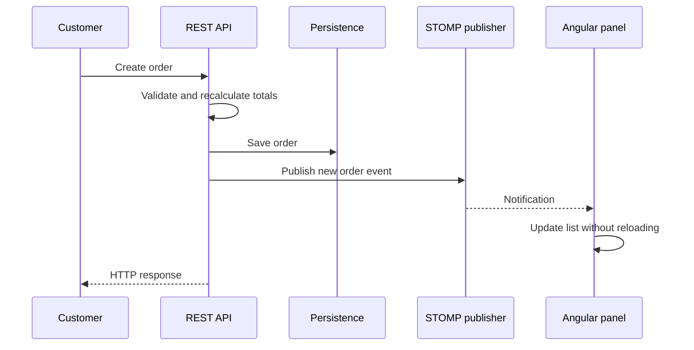

# Real-time communication

[Versión en español](../realtime.md) · [README](../../README.md)

The backend uses Spring WebSocket, STOMP and a simple in-memory broker. Angular uses STOMP.js, SockJS, RxJS and Signals to receive events and update the panel.

The diagram illustrates the logical service flow, not a guarantee of delivery after transaction commit.

The panel initially loads orders through REST. On a new event it updates the list by ID to avoid duplicates; on status changes it replaces the corresponding order. The STOMP client configures reconnection after five seconds and resubscribes on connection. Event persistence, exactly-once delivery and automatic missed-message recovery are not claimed.

## References

- [Event publisher](../../backend/src/main/java/com/stickyburgers/service/PedidoEventPublisher.java)
- [Frontend real-time service](../../frontend/src/app/core/services/realtime.service.ts)
- [Order panel](../../frontend/src/app/features/panel/pages/pedidos/pedidos.ts)

This is a portfolio project; any public deployment requires review of event-channel authorization and data minimization.
