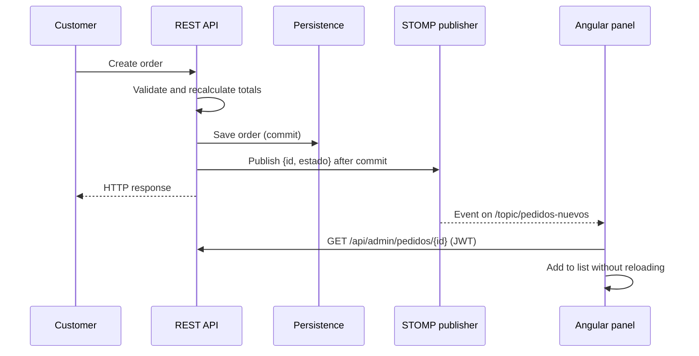

# Real-time communication

[Versión en español](../realtime.md) · [README](../../README.md)

The backend uses Spring WebSocket, STOMP and a simple in-memory broker. Angular uses STOMP.js, SockJS, RxJS and Signals to receive events and update the panel.

## Channel security

- The `/ws` endpoint (SockJS) is public at HTTP level because browsers cannot send headers during the handshake. Security is enforced on every STOMP frame.
- The panel sends the login JWT in the CONNECT frame as the STOMP header `Authorization: Bearer <jwt>`. The token is never placed in the URL. It is validated by the same JWT service as the REST API.
- Deny by default:
  - CONNECT requires the ADMIN role.
  - SUBSCRIBE is only allowed with the ADMIN role, to `/topic/pedidos-nuevos` and `/topic/pedidos-estado` (no wildcards).
  - Any SEND or other destination is rejected with an ERROR frame and the session is closed.
- When the token expires, the session stops receiving messages: the next MESSAGE is replaced by an ERROR and the server closes the connection.
- Events only contain `{ "id", "estado" }`, with no personal data. They are published after the transaction commits: orders that cannot be read yet and rolled-back changes are never notified.

## Panel behavior

The panel loads orders through REST.
- **New order:** fetches the details by ID and adds the order without duplicates.
- **Status change:** updates the status locally.

The STOMP client:
- retries every five seconds only on connection drops;
- on an authentication rejection (ERROR frame) it does not retry: it ends the panel session and returns to the login page;
- disconnects on any logout;
- reloads the list through REST after reconnecting, to recover missed events.

Reloads keep a single request in flight. A REST response never overwrites changes received after it was sent.

Event persistence and exactly-once delivery are not claimed: recovery relies on the REST reload after reconnecting.

## References

- [STOMP configuration and authorization rules](../../backend/src/main/java/com/stickyburgers/config/WebSocketConfig.java)
- [CONNECT JWT authentication and expiration](../../backend/src/main/java/com/stickyburgers/security/JwtStompInterceptor.java)
- [Event publisher](../../backend/src/main/java/com/stickyburgers/service/PedidoEventPublisher.java)
- [Frontend real-time service](../../frontend/src/app/core/services/realtime.service.ts)
- [Order panel](../../frontend/src/app/features/panel/pages/pedidos/pedidos.ts)

Limitations:
- A session with an expired token and no traffic stays open until the next event or until it disconnects, but receives no data.
- The panel stores the JWT in `localStorage`.
