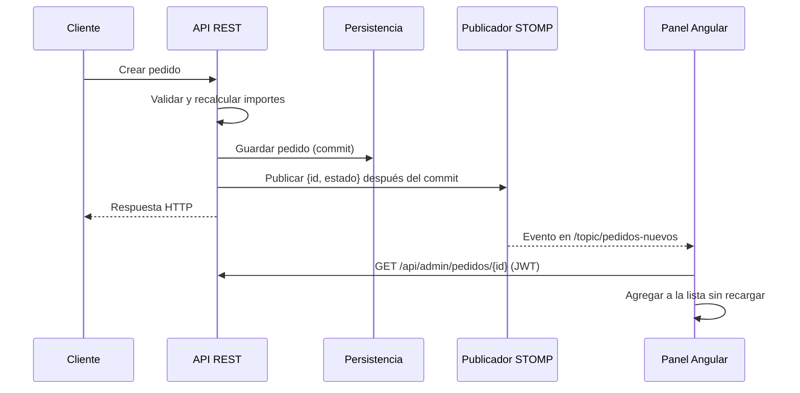

# Comunicación en tiempo real

[English version](en/realtime.md) · [README](../README.es.md)

El backend utiliza Spring WebSocket, STOMP y un broker simple en memoria. Angular utiliza STOMP.js, SockJS, RxJS y Signals para recibir eventos y actualizar el panel.

## Seguridad del canal

- El endpoint `/ws` (SockJS) es público a nivel HTTP porque el navegador no puede enviar headers en el handshake. La seguridad se aplica a cada frame STOMP.
- El panel envía el JWT del login en el frame CONNECT, como header STOMP `Authorization: Bearer <jwt>`. El token nunca va en la URL. Se valida con el mismo servicio JWT que la API REST.
- Deny by default:
  - CONNECT requiere rol ADMIN.
  - SUBSCRIBE solo se permite con rol ADMIN y a `/topic/pedidos-nuevos` y `/topic/pedidos-estado` (sin comodines).
  - Cualquier SEND u otro destino se rechaza con un frame ERROR y se cierra la sesión.
- Cuando vence el token, la sesión deja de recibir mensajes: el siguiente MESSAGE se reemplaza por un ERROR y el servidor cierra la conexión.
- Los eventos solo contienen `{ "id", "estado" }`, sin datos personales. Se publican después de confirmar la transacción: no se notifican pedidos que todavía no se pueden leer ni cambios revertidos.

## Comportamiento del panel

El panel carga los pedidos mediante REST.
- **Pedido nuevo:** pide el detalle por ID y lo agrega sin duplicar.
- **Cambio de estado:** actualiza el estado localmente.

El cliente STOMP:
- reintenta cada cinco segundos solo ante caídas de conexión;
- ante un rechazo de autenticación (frame ERROR) no reintenta: cierra la sesión del panel y vuelve al login;
- se desconecta en cualquier logout;
- al reconectar, recarga la lista por REST para recuperar los eventos perdidos.

Las recargas dejan una sola solicitud en curso. Una respuesta REST no sobrescribe los cambios recibidos después de su envío.

No se afirma persistencia de eventos ni entrega exactamente una vez: la recuperación se basa en la recarga REST al reconectar.

## Referencias

- [Configuración STOMP y reglas de autorización](../backend/src/main/java/com/stickyburgers/config/WebSocketConfig.java)
- [Autenticación JWT del CONNECT y vencimiento](../backend/src/main/java/com/stickyburgers/security/JwtStompInterceptor.java)
- [Publicador de eventos](../backend/src/main/java/com/stickyburgers/service/PedidoEventPublisher.java)
- [Servicio de tiempo real del frontend](../frontend/src/app/core/services/realtime.service.ts)
- [Panel de pedidos](../frontend/src/app/features/panel/pages/pedidos/pedidos.ts)

Limitaciones:
- Una sesión con el token vencido y sin tráfico permanece abierta hasta el próximo evento o hasta que se desconecte, pero no recibe datos.
- El panel guarda el JWT en `localStorage`.
