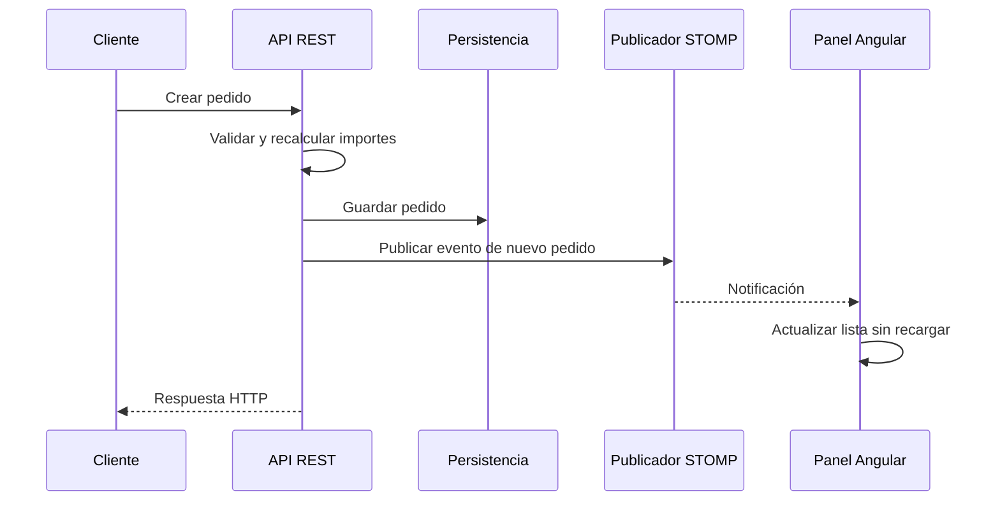

# Comunicación en tiempo real

[English version](en/realtime.md) · [README](../README.es.md)

El backend utiliza Spring WebSocket, STOMP y un broker simple en memoria. Angular utiliza STOMP.js, SockJS, RxJS y Signals para recibir eventos y actualizar el panel.

El diagrama muestra el flujo lógico del servicio, no una garantía de entrega posterior a la confirmación de la transacción.

El panel carga inicialmente los pedidos mediante REST. Ante un nuevo evento actualiza la lista por ID para evitar duplicados; ante cambios de estado reemplaza el pedido correspondiente. El cliente STOMP configura reconexión a los cinco segundos y vuelve a suscribirse cuando se conecta. No se afirma persistencia de eventos, entrega exactamente una vez ni recuperación automática de mensajes perdidos.

## Referencias

- [Publicador de eventos](../backend/src/main/java/com/stickyburgers/service/PedidoEventPublisher.java)
- [Servicio de tiempo real del frontend](../frontend/src/app/core/services/realtime.service.ts)
- [Panel de pedidos](../frontend/src/app/features/panel/pages/pedidos/pedidos.ts)

El sistema es un proyecto de portfolio; cualquier puesta en marcha pública requiere revisar la autorización del canal de eventos y la minimización de datos.
